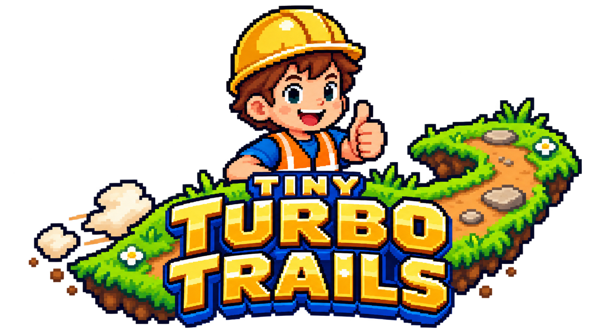

<p align="center"></p>

# Tiny Turbo Trails

A forgiving, illustrated platform game for Henry. Explore six open trails:
Plains, Quarry Run, Treetop Timbers, Sunset Site, Frost Ridge and Sandy Cove.
Choose a landmark on the overworld, collect gems and reach the finish.
Plains, Quarry Run and Treetop Timbers also offer three optional gold stars each;
follow the slope, lift and spring signs to explore their signature challenges.

## Published release

[v0.1.0 — First playable six-trail release](https://github.com/auleewilliams/TinyTurboTrails/releases/tag/v0.1.0)
is pinned to commit `bee0f7d402395af8d9ed7a4693e6739d9f905607`.
The release notes link exact-commit test evidence, the verified container digest,
remaining manual-check limitations and the process for future releases. This is
an early playable milestone, not a claim that development is finished; newer
`main` changes are not part of the published tag. See the
[documentation index](docs/README.md) for current guidance and historical records.

## Play locally

Install Node.js 22.12 or newer, then run:

```sh
npm ci
npm run play
```

This starts Vite and opens the game. Use the URL it prints if the browser does
not open. Both `/` and `/?scene=adventure` start on the trail map with Plains selected.
Henry explores Patchwork Vale: choose any of the six open trails and play.
Stop the local server with Ctrl+C. An adult sets this up for local play.

For an already configured home server, open its LAN address instead; no local
development server is needed. [LAN setup and updates](docs/DEPLOYMENT.md) cover
Docker/nginx deployment and rollback. Public internet hosting is outside scope.

## Controls

| Action | Keyboard | Standard controller | Pointer |
| --- | --- | --- | --- |
| Choose trail / finish action | Left/Right or A/D | D-pad / left stick | Click landmark / action |
| Play / confirm | Space; Tab and Enter on buttons | Any face button | Play / action button |
| Move | Left/Right or A/D | D-pad / left stick | Not supported |
| Jump | Space | Any face button | Not supported |
| Pause / resume | Escape | Start | — |
| Mute | M | — | Mute button |

Henry celebrates each finish with a jump and cheer (a still pose with reduced motion).
Results come first: no activity covers the finish. Its buttons read Next trail, Map,
Build your word and Replay, matching their accessible names. Next trail is selected and starts the next registered trail;
on Sandy Cove, the final trail, Map is selected instead (there is no wrap-around). Map returns to the map, Build your word
opens the optional word activity, and Replay starts the same trail fresh. Leaving the activity reselects Next trail (or Map). Checkpoint recovery retains gems and special
stars; replay, changing trails and reload clear the run's stars. Completion
badges and each trail's best gem/star results last for this page session only;
the selected trail's map panel shows those results. Replaying with fewer pickups
keeps the earlier best for each kind. Reloading clears all
session results. Nothing is saved
to browser storage or a server. See the [adventure guide](docs/plains-adventure.md).

## Develop

```sh
npm run dev           # Local server without opening a browser
npm test              # Vitest regression suite
npm run typecheck
npm run build         # Production bundle in dist/
npm run preview       # Serve the production bundle after building
npx playwright install --with-deps chromium firefox webkit
npm run test:browser  # Production-build browser checks
```

### Run and debug in VS Code

After `npm ci`, open the repository folder in VS Code with Node.js 22.12 or newer
on PATH and Google Chrome installed. Select **Tiny Turbo Trails (Vite + Chrome)**
in Run and Debug, then press **F5**. VS Code starts Vite and opens the adventure
in a Chrome debug session once the server is ready. Set breakpoints in `src/` to
debug the game; Vite keeps hot reload enabled. The actual URL is in the Debug
Console, including a different port if 5173 is already busy.

To finish, stop the **Tiny Turbo Trails (Vite + Chrome)** server session in the
debug toolbar; this also stops its Chrome debug session. No separate terminal
command or task is needed.

Asset-processing tests also require Python 3 (`python` on Windows, `python3`
elsewhere). The static bundle needs an HTTP server; opening `index.html` as a
local file is unsupported. No credentials or runtime generation are needed.

[Documentation index](docs/README.md) · [Requirements](docs/REQUIREMENTS.md) ·
[Art and provenance](docs/art/README.md) · [Audio](docs/AUDIO.md)

The [2026-09-17 certification](docs/RELEASE-VERIFICATION-2026-09-17.md) is historical
and does not certify later features. The [trail milestone record](docs/evidence/trail-milestone/README.md)
retains its earlier scope. The [Henry / Patchwork Vale milestone](docs/evidence/henry-patchwork-vale/README.md)
records the celebration and the since-retired illustrated opening. The current
[exploration premise and owner-led checklist](docs/patchwork-vale-story.md) follow #195.
