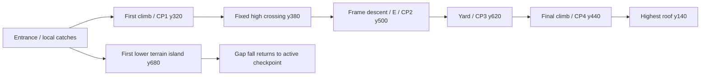

# Sunset Site scaffold route — issue #221

The route climbs the first scaffold to CP1, crosses the fixed lower work deck,
descends through the frame past E/CP2 into the calm CP3 yard, then climbs the
taller final scaffold past CP4 and M to the highest roof. The automatic crane
is an optional upper discovery; A stands on its far fixed dock. The route spans
3120 world pixels. The high crossing is at y320, the yard at y620 and the roof
at y140. Four checkpoints reactivate in either travel direction without losing
collected rewards or completed-trail history.

[Level data](../src/world/sunset-site.ts) uses permanent one-way support tops.
Dark posts, braces and machinery are pass-through scenery. Most adjacent tiers
rise 60 pixels. Both panel joins have a fixed support spanning the seam. The
96-pixel crane moves between x470 and x554 at y320, taking 1.4 seconds each way
and pausing 1.2 seconds at each dock. The fixed y380 deck covers its entire
travel and both boarding edges. Walking off the near dock's left edge provides
a main route that cannot accidentally board an arriving carriage.

The entrance itself is x0–300 at y560. The adjoining x280–720 top is a local
right-side catch, so the combined y560 floor still ends at720. Its lower catch is
x0–840 at y620, then terrain x0–960 at y680. These supports lead back into the
first tower. They do not join the later yard. The visible terrain gap from x960
to1340 descends to y1000; walking into it invokes existing fall recovery at the
active checkpoint. It is outside the intended route, not a new damage mechanic.
The high fixed crossing spans x340–1900 at y380 over that gap. The descent's
left catches step through x1700@y500, x1580@y560, x1460@y620 and terrain beginning
at x1340@y680. All exposed fixed-platform edges retain a settled catch no more
than60 pixels below and an ordinary fixed-support rejoin. Continuing to walk off
the lower terrain island is tested separately as a recovery, not a local landing.

The earlier 93 single-jump takeoffs did not establish sequence safety. Independent
review of7292fdd found ten of840 takeoffs could ground on the far terrain wall,
jump again, reach the yard and finish with onlyCP4. The initial final-climb pilot
stalled at the yard; continuing ordinary jumps from that actual support finished.
Those counterexamples and the initial stall remain preserved.

The far wall now begins at1320,140px beyond its former1180 start. This is outside
a conservative reach-and-recovery envelope, not a sampled one-pixel adjustment.
With unchanged speed220, jump510, gravity1500, coyote0.1s, maximum callback0.1s
and recovery feet874, grant a fresh launch at x980 with feet680 (higher and farther
right than any live first-island terrain contact). Full-hold airtime to874 is
0.952s. Adding full coyote travel22px, an entire callback22px and body half-width9px
gives x<1243, over77px before the wall. Lower-catch and entrance launches have
smaller bounds despite their higher tops. The y380 crossing cannot be reached
from the lower island. The y1000 floor is below recovery, so it cannot renew a
jump; no other live landing exists between the envelope and the far wall. Stop,
reverse and early release cannot exceed this full-speed/full-hold bound. Terrain
snapping, recovery height and ordinary9px platform overhang remain unchanged.
This argument covers the lower-island route; it does not claim exhaustive model
checking or human comfort. Main forward and reverse travel use the fixed bridge.

[Wall-contact regressions](../tests/sunset-wall.test.ts) preserve the reviewer's
exact pre/k definitions and seven cadences.143 expanded unit identities exercise
2271 actual entrance journeys: three primary witnesses, all840 original takeoffs,
840 repeated-contact variants and588 pause/reverse/short-hold variants. A contact
permits another ordinary jump and actual reached terrain/yard gets continued
movement toward a real finish; a stale pilot stall cannot satisfy the negative.
All original fifteen negatives remain. New native cases observe exact sprite and
fixed-girder draw coordinates with actual keyboard input, record physical ascent
and try further jumps on any reached terrain contact; native scheduling is not
claimed to reproduce a forced simulation cadence.

The extra horizontal separation is authored tuning of the nominal sketch: it
prevents lower catch travel from becoming a shortcut while preserving generous
landing/braking room. The final tower starts at2440. Current section names use
authored horizontal/height bands, so the roof has its own label independently
of the four checkpoint slots.

The rooftop finish requires a grounded body at y140 inside x3050–3096.
Find more letters returns to x2930 on the same roof with no inherited motion.
Completion is disarmed until moving left to x2870 or descending to y200.
Lower crossings of finish X remain inert. M, the return point and the arch have
separate standing areas. Existing results-first word building and replay remain.

`verticalCamera` and `cameraLead` separate support framing from ribbon progress.
Sunset retains horizontal progress through the rise/descent/rise sequence;
the marker moves back during retracing while completed results and visited posts
remain. It uses the existing site panorama, girder tiles, machinery, checkpoint,
gem and finish assets. The native view leads forward on crane approaches.

## Evidence and proof boundaries

The old 10,000-pixel route was observed before replacement, at base
`7b6e62b1e76b57907e1a3862f9e24d281d2ee59c`, using Chromium 156.0.8078.4,
viewport 426×300 and native canvas 426×240. One keyboard-event pilot attempt
reached the actual finish, without recovery, with 55/62 gems and all four letters.
The repeated trench/finale spring-pit pairs and long ground runs shared the same
rhythm. The warm skyline, crane silhouettes and checkpoint feedback read clearly.
Crane optionality was not established for a new player. The driver accelerates
quiet stretches: this is not a human-duration or enjoyment observation.

Task-local raw source, input histories, logs, screenshots and provenance remain
under `/home/leew/.hermes/cache/scratch/m8-221-evidence`. Correction evidence is
separate in `/home/leew/.hermes/cache/scratch/m8-221-review-fix-evidence`; wall-correction evidence is
`/home/leew/.hermes/cache/scratch/m8-221-wall-fix-evidence`; original
source, working images, failed reports and review findings remain unchanged. The worker handoff records
exact source revisions, outcomes and final native report identities. Historical
certification worksheets are unchanged.

- [Bypass regressions](../tests/sunset-bypass.test.ts): held-right, actual entrance
  and first-girder walk-offs, full running jumps and coyote-edge jumps at16/32/mixed
  cadence cannot reach later supports or complete the final climb. Positive main
  journeys separately require ordered first deck→crossing→descent→yard→roof contact.
- [Scaffold regressions](../tests/sunset-scaffolds.test.ts): strict zero-letter,
  no-crane main finish; actual finish→BEAM→roof without restart at 16ms, 32ms and
  mixed cadence, neutral pauses, variable jump duration, reward retention,
  checkpoint reactivation and supported finish independence.
- [Edge fixtures](../tests/sunset-catches.test.ts): every combined fixed top's
  two ends, held direction/release/brake, three cadences, a settled local catch
  within 60 pixels, and an input-driven fixed-support path back to the source.
  These begin prepositioned at the tested support and are not complete journeys.
  The moved left y500 catch now joins E at the same height:558 actual combined-top
  cases replace576 former cases because the internal touching edges disappear;
  both exposed ends and all safety/rejoin predicates remain.
- [Crane fixtures](../tests/sunset-crane.test.ts): both directions, seven phase
  starts and three cadences; boarding or a safe catch and input return to both
  fixed docks. [Carry/step-off fixtures](../tests/sunset-site.test.ts) also inspect
  moving support identity and all four leading/trailing exits at three cadences.
  Six additional fixtures require positive boarding, carried movement and walking
  onto the opposite fixed dock. Clock fixtures are labelled.
- [Exploration](../tests/sunset-exploration.test.ts): all 62 stable gem IDs are
  collected in a single input journey, including catch-shelf bonuses. Zero stars.
- [Native browser journeys](../tests/sunset-scaffolds.spec.ts): main route at
  native, small and large sizes, actual all-missing return, M-only and A-only
  trips, manual BEAM assembly and walking crane boarding in both directions.
  The shared milestone, spelling, renderer/glyph and damage/patrol cohorts remain.

## Coverage reconciliation

Old Sunset geometry tests required seven checkpoints, five springs, four pits,
10,000-pixel length, per-section enemy counts and held-right damage. Those
requirements were superseded by the approved four-checkpoint fixed-scaffold
route. Their source is preserved in the task evidence. Palette/registration,
reward identities, reachable optional rewards, safe recovery, completed routes
and deterministic optional ferry semantics have explicit replacements above.
The shared horizontal spelling case retains its case identity and uses the
stacked-support input driver for Sunset. It still requires the deliberately
missed letter to be absent, partial assembly to survive, no recoveries, all four
letters to return, correct sticker creation and a fresh reload to start empty.

Shared sprite-damage, heart-depletion, controller-rumble and stationary-patrol browser tests now use
the existing Plains orchard slime. The patrol witness stops on its actual flat
x1900–1960 and keeps exact stationary-X assertions. The old Sunset ribbon-valley geometry is retired. The live yard capture proves
route state only. The shared compact HUD renderer fixture draws the actual Henry
atlas with feet at logical y230: sprite bottom > ribbon y221 AND sprite top <
ribbon bottom235 AND sprite right <= ribbon left285. This preserves the original
nonvacuous band-overlap plus horizontal-clearance obligation; being above the
ribbon cannot satisfy it.
Renderer fixture graphs include the scaffold helper and retain dependency guards.
Historical full CI40437011667 also exposed three controller-rumble failures:
the unchanged test still selected the removed Sunset slime encounter. Its target
is now the existing Plains orchard slime, with controller oscillation1660–1820
and retreat to the flat x1560–1620 rest. All actual rendered-health/actuator,
muted/off/on, sustained movement, neutral acknowledgement, pause, focus-loss and
disconnect assertions and original deadlines remain. No skip, retry, frame-guard,
timeout, physics or coverage-engine relaxation is used.
The original missing-catch mutation remains historical evidence. A new temporary
lower-floor bridge makes the bypass regressions fail; the exact source is restored.
The independent6978 native failure remains preserved. A bounded real far-dock
overshoot/reverse diagnostic reproduced its cached screen-target defect (cached
−46 versus actual dock−72.97). Same-frame carriage/dock comparison fixes the
observer while preserving0.5px/8s/retry0 and bidirectional ride assertions. No
production crane, movement or camera timing change was needed.

Owner-led enjoyment, clarity, waiting, retry encouragement and rooftop payoff
remain unobserved. Physical controller, child, hardware Safari and assistive
technology checks are unperformed. Automated WebKit is not hardware Safari.
Fresh opposite-family review, complete PR CI/artifact verification, and owner
acceptance remain coordinator gates. This worksheet does not certify those gates.
