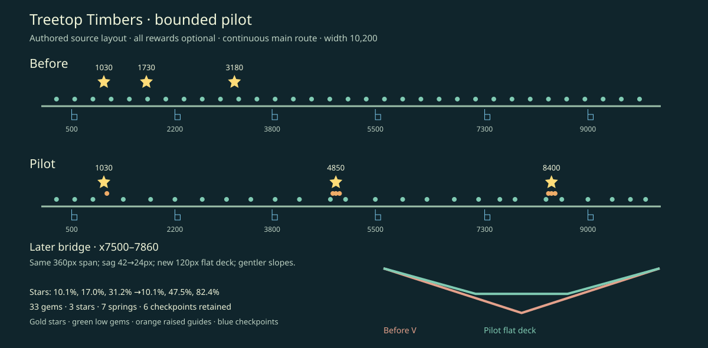

# Treetop Timbers exploration pilot (#171)

Local review only. Base: `788ec08bae09affeb289369533afb537941bdede`.
Branch: `codex/timbers-exploration-pilot`. This is one bounded Timbers pilot;
other trails still need separate design review.

## What changes for the player

The first star remains the running-spring introduction. The next two stars now
reward slowing over existing middle and late springs and holding jump through
the bounce. Continuing along the ground still reaches the finish without them.
Existing gems form short rising and returning groups around these choices.
One later bridge becomes a shallow crossing with a broad flat bottom, creating
a quieter stretch before the last optional spring.

| Element | Before | Pilot |
| --- | --- | --- |
| Stars (x, y) | (1030, 70), (1730, 70), (3180, 95) | (1030, 70), (4850, 30), (8400, 40) |
| Star position along 10,200px route | 10.1%, 17.0%, 31.2% | 10.1%, 47.5%, 82.4% |
| Gems | 33 uniformly spaced, low | Same 33 IDs; short spring-flight groups and low connecting rewards |
| Landing guidance | Centers 1100, 1820, 3320; width 140 | 1100/140, 4960/180, 8510/180 |
| Bridge x7500-7860 | 42px V sag; slopes 42/180 | 24px sag; 120px flat deck; slopes 24/120 |

Start/finish, seven springs, six checkpoints, all hazards and slime patrols are
unchanged. The continuous ground has no new gaps. Reward counts remain three
stars and 33 gems. No new mechanics, signs, assets or persistent state were added.

This diagram and [layout-comparison.json](layout-comparison.json) compare authored
source data; they are not measurements of play or enjoyment. The bridge is drawn
in a separate enlarged inset; the overview shows horizontal reward distribution.

## Executed verification

On Windows, Node 24.19.0, using lockfile dependencies:

| Command | Result |
| --- | --- |
| `npm test` | 705 passed, 38 files; measured Vitest duration 24.14s |
| `npm run typecheck` | Passed |
| `npm run test:ci` | 8 passed |
| `npm run build` | Passed; production JS `index-DUbmCZQC.js` |
| `npx playwright test --project=chromium --project=webkit --workers=2 --retries=0 --reporter=dot,json` | **178 passed, 1 skipped, 1 failed**; measured report duration 19m09.903s (Chromium 90/90 passed; WebKit 88 passed, 1 skipped, 1 failed) |

The new deterministic tests exercise the whole easy route with no checkpoint
rewind and fewer than three damage events; all stars at three aim offsets
(-8/0/+8px); grounded arrivals in all three landing bands; and a single spring
launch for each higher reward. Removing springs in isolated movement/entity
fixtures makes the higher stars unreachable. Every gem has an individual local
pickup fixture; this does not claim a 33-gem perfect full run. Both recovery paths
preserve the exact earned reward sets in a deterministic fixture. Earlier failed
approach cases at 950, 1650 and 3100 remain and new cases at 4850 and 8400 are added.

The existing browser signature pilot follows the relocated optional targets and
retains its finish/3-star, small-viewport, navigation, reload and no-signboard
assertions. It uses its existing accelerated clock between challenge regions;
that regression evidence is distinct from the native-clock runs below.

Full regression details and per-case measured durations are in [browser-regression.json](browser-regression.json). The skip was WebKit native audio: this host has no working audio backend. The failure was the unchanged Quarry controller-rumble case at `tests/browser.spec.ts:252`: after re-enabling rumble, the observed effect count stayed at 1 instead of becoming greater than 1. The complete cohort remains failed; isolated diagnostics are recorded separately below.

## Native-clock browser observations

These are executed scripted keyboard playthroughs, using the production build,
real browser RAF timing, debug position text and observed canvas counters. They
use no scene access, teleports, reward writes or disabled hazards. They establish
mechanical feasibility, not whether a first-time player finds the choices fun.

| Build and browser | Observed result |
| --- | --- |
| Baseline Chromium 153.0.8010.12 | 3/3 stars already earned before x4770; finishes, replay resets to 0/3 |
| Pilot Chromium 153.0.8010.12, main route | Finishes with 1/3 stars and 27/33 gems; replay resets |
| Pilot Chromium 153.0.8010.12, optional plus health recovery | Middle landing 2/3; late landing 3/3; deliberate depleted-health recovery to x7300 retains 3/3; gem count 24 to 25 while backtracking; finishes with 3/3 and 28/33 gems; replay resets |
| Pilot WebKit 26.6, optional route | Middle landing 2/3; late landing 3/3; finishes with 3/3 and 27/33 gems; replay resets |

All four runs recorded no page errors. Pilot bundle identity was
`index-DUbmCZQC.js`. Native recovery observed counters, while the deterministic
fixture checked exact reward IDs. The before/after controllers and stops differ,
so gem totals and elapsed times are not performance or difficulty comparisons.
See [native-observations.json](native-observations.json) for captured positions,
versions, counters and viewports. One successful Chromium-main node run had an
unrelated invalid trailing shell command in its wrapper; its completed browser
observations were checked directly rather than rerunning the route.

Native screenshots are actual browser renders at 852x528, including a 852x480 canvas
(logical game size 426x240). They are not generated artwork. Baseline images use
the original layout; after images use the final pilot, including gem spacing.
The images were inspected for reward visibility, HUD clipping and bridge shape.
Both higher rewards remain on screen and clear of the HUD in the two tested engines. The central guide gem sits close below each star; owner play should check that the pair reads clearly.

| Pose | Before (Chromium) | Pilot (Chromium) |
| --- | --- | --- |
| Middle approach | [Before](before-middle-approach.png) | [After](after-middle-approach.png) |
| Later bridge | [Before](before-bridge.png) | [After](after-bridge.png) |
| Late approach | [Before](before-late-approach.png) | [After](after-late-approach.png) |

Additional evidence: [middle landing](after-middle-landing.png),
[late landing](after-late-landing.png), [health recovery](after-checkpoint-recovery.png),
[finish](after-finish.png), [WebKit late approach](webkit-late-approach.png).

The full-suite signature pilot also produced [WebKit middle approach at 320x240](webkit-middle-320.png) and [late approach at 320x240](webkit-late-320.png). These small-viewport images were inspected; the middle star stays visible and clear of the HUD. They use the regression pilot clock described above, rather than the native-clock observation script.

The unchanged rumble test was then run separately on (1) an archive of base `788ec08` and (2) the pilot, with WebKit, one worker and zero retries. Both passed. The test source was identical in the compared block. This suggests sensitivity to execution context, but does not establish the full-run failure cause or make the full cohort green. [Isolated diagnostic results](rumble-diagnostics.json).

## Remaining review and limits

Firefox cannot launch on this Windows host: the existing Playwright executable
fails with `spawn UNKNOWN` and a SideBySide/mozglue activation problem. No system
repair was attempted. The Firefox project, assertions, retries and timeouts remain
unchanged; Firefox verification is pending on a working host. No CI run was
triggered because this pilot is authorized for local review only.

Before extending to other trails, owner play should assess whether the gem groups
suggest braking/holding jump naturally, whether skipping versus trying the high
stars feels like a useful choice, and whether the later bridge changes the pace.
Automated feasibility and screenshots cannot answer those questions. The two
later rewards intentionally require more attention than the introductory running
arc; the mandatory ground route remains continuous.

To review locally: `npm run build`, then `npm run preview -- --port 4182`; open
`http://127.0.0.1:4182/?debug=1`, skip the story, choose TREETOP TIMBERS and play.
At the two later springs, slow over the spring and hold jump while bouncing to
reach the high star; moving straight on skips the optional reward.

The full browser suite also rewrote three tracked issue-162 PNGs (confirmation-small.png, controller-pause.png, keyboard-pause.png). Automatic approval review denied restoring them as pre-existing modifications. They are left untouched and excluded from this pilot commit; no restore workaround was used.
