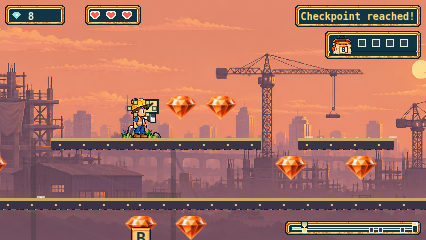
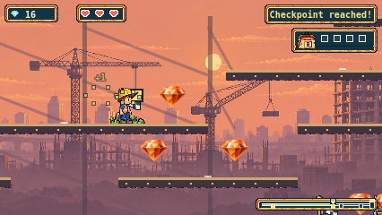
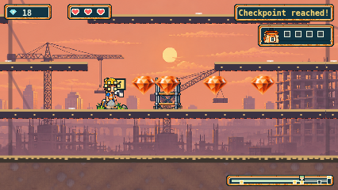
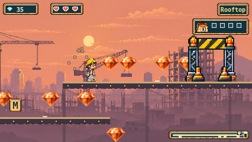

# Sunset scaffold working-source captures

These native Chromium 156.0.8078.4 captures use a 426×300 viewport and the
426×240 canvas. [working-capture.json](working-capture.json) records the exact
base plus working production diff hash, input-stage histories,
PNG SHA-256 hashes, browser and viewport. The keyboard pilot moves from the real
entrance, finishes with zero letters, uses Find more letters, recovers BEAM and
returns to the roof. No player/run state is injected.

These replace the earlier geometry images after the independent6978 review.
The original eight PNGs and manifest are preserved under correction evidence
`inherited-source/working-images`; the original raw evidence remains unchanged.
The corrected lower catches form separate recovery islands, documented in the
[current route and catch graph](../../SUNSET-SCAFFOLDS.md). A held-right-only native
probe observes two recoveries into the first section before the first climb.
Loaded asset responses/hashes are recorded separately by the final stable-head
probe; this working gallery does not claim that probe as part of these captures.

These are pre-commit working-source captures. Final clean committed-head native
reports, configured identities and strict artifact verification are separate in
the task evidence directory and worker handoff. They are not owner playtesting.

| Near fixed dock and lower catch | Frame descent |
| --- | --- |
|  |  |

| Lower yard | Highest roof |
| --- | --- |
|  |  |

Additional views: [entrance](entrance.png), [final rest deck](rest.png),
[far fixed A dock](far-fixed-dock.png), [B after actual retrace](B-return.png).

Enjoyment, clarity, waiting, encouraging retries, rooftop payoff, physical
controller, child, hardware Safari and assistive technology remain unobserved.

The final takeoff sweep subsequently moved the first lower catch end from880 to840
and the terrain lip from1000 to960. These upper-route working views retain their
original source hash; they are not relabelled as final-head captures. The final
native held-right case separately captures the corrected lower-island lip, with
source/browser/viewport and PNG hashes in the worker evidence.

The subsequent7292 wall-contact review invalidated the single-jump safety claim.
The former images and manifest above remain historical. The current
[lower-island lip](wall-fix-lower-lip.png) is an actual held-right input capture
before recovery, from the wall correction's working source.
[Its manifest](wall-fix-working-capture.json) records exact source/diff and PNG
hashes. The far terrain wall now starts at1320 and the moved descent steps follow
the current guide; the former descent image shows the former step positions.
Separate new native multi-jump journeys require physical ascent, observe exact
rendered terrain contacts and keep subsequent ordinary jumps available. These
working images do not claim final stable-head provenance or owner acceptance.
