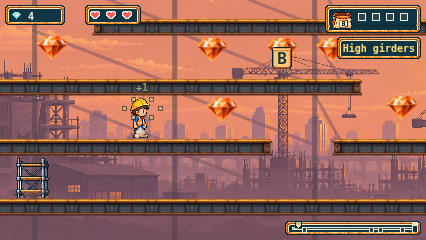
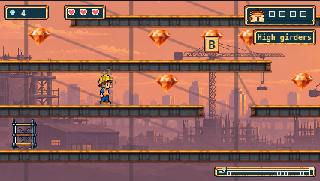

# Remove fixed Sunset platform path markers

On 2026-11-02 the owner requested removal of the white T marks centered above
the steel platforms, illustrated in their gameplay screenshot. The marks were
overlapping movement-path endpoints on stationary supports, drawn separately
from the approved PNGs.

The renderer now omits path indicators for fixed Sunset supports. The moving
ferry's full route indicators remain. Artwork, platform geometry, carrying,
timing, gems and other trails are unchanged. No generation calls were used.
The previous rollout record and evidence remain unchanged; the separate
`assets/source/site/steel-v1/marker-removal-preservation.json` pins this correction.

## Validation

- Typecheck and production build passed.
- Focused renderer/site units: 63 passed, including a new assertion that the
  complete Sunset render draws exactly the ferry's path markers and all 32
  steel images. The same stationary support data retains its markers outside
  Sunset.
- Script suite: 103 passed, including exact asset reproduction and preservation.
- Browser matrix: all 12 configured journeys passed across Chromium, Firefox
  and WebKit at 426px and 320px, covering the full route, ferry in both directions,
  absent-ferry recovery, reduced motion and Pause. Zero retries or skips.
  Strict report reconciliation verified 426 file attachments; readback compared
  1,152 source hashes and 1,032 served/build bodies with the current checkout.
- Full unit suite: 1,950 passed; two tests in the unchanged `finish-layout.test.ts`
  hit their existing 5,000ms deadline (0-gem and 1-gem composition cases).
  These are retained in `units.log.gz`. This file had historical timing failures;
  no root cause, fix, deadline change or waiver is asserted.

Browser result and source/build evidence are recorded in `readback.json`.
The original observations and provenance are copied without edits; their
precommit `sourceRevision: null` remains honest. Source hashes bind the runtime
bytes separately from the recorded previous working commit.

## Gameplay screenshots

Actual ordinary-input stacked-girder scene, native 426×240:

Actual 320px CSS display, reduced motion:

These captures were visually inspected. The prior whole-PR review and CI at
`d24cdf3` remain historical evidence, not verification of this correction.
Completed-trail owner acceptance remains separate and pending.
