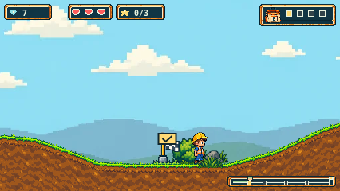
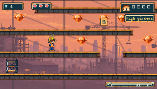

# Integrate merged Plains artwork

Main advanced to `fbf98b93d0c28e7cd393b1b7213a3dc2b3a2bacb` when PR #245
merged. This update merges that main revision into the Sunset branch after
`681607848729d50ceeea415e3653fd58c4b198ef`.

The shared loader retains both independent asset families and their validation
and Retry behavior. The shared renderer retains Plains contour rendering,
Sunset steel/gravel rendering, and Sunset-only stationary-marker removal.
The manual renderer/HUD/map fixture graphs include both terrain helpers.

Historical preservation checks compose in order: remove the exact recorded
Sunset integration to recover the merged-main bytes, then apply the unchanged
Plains projection before the older Cove guards. The new
`plains-main-preservation.json` stores exact merged hashes and immutable copies
of main's loader/renderer. Earlier source records are unchanged. Both trails'
negative controls remain active; no deadline, retry or assertion was relaxed.

An independent byte audit retained in `preservation.json` verifies 110 main
runtime files outside the four explicitly approved Sunset integration/data
paths, and all 74 pre-existing Sunset artwork/provenance files. The new main
Plains geometry and art remain intact. No new artwork or generation calls.

## Local verification

- Typecheck and production build passed.
- Focused loader/renderer, both trail art families and Cove preservation:
  65 unit tests passed in seven files.
- Full script suite: 110 passed.
- Full unit suite: 2,043 passed and one 5,000ms timeout in unchanged
  `finish-layout.test.ts` (42-gem composition case). The log is retained.
  Historical finish-layout and missed-letter deadline failures remain
  unexplained; no root-cause fix or waiver is claimed.
- Selected browser matrix: 40 passed, two failed, zero skips or retries across
  42 configured cases. All Sunset routes/Retry and all shared HUD/map fixtures
  passed. Both failures are WebKit Plains grass/soil Retry movement goals.
  Loading recovered, but the subsequent traversal exceeded its 20-second budget.
- Both WebKit failures reproduce at the same assertion on an untouched archive
  of main `fbf98b9`, independently built with the same dependencies; all 114
  baseline runtime files were checked against main's Git blobs. Both trees'
  controller histories show frequent late-frame braking. This establishes
  reproduction on main, not an underlying timing fix or waiver. Original traces,
  reports and histories remain in the local test-results folder; compact hashes
  and comparison are in `baseline-comparison.json`.
- Strict browser readback reconciled all 42 identities, checked 397 file
  attachments (plus 156 inline attachments), 714 source hashes and 607 served
  bodies against the current build. All failures remain marked failed.
- Independent full-suite enumeration contains 804 browser cases for fresh CI.

Browser identities, outcomes, attachment verification and runtime source/build
bindings are retained separately in `browser-summary.json` and `readback.json`.
The precommit browser records retain null sourceRevision and the previous
working commit; exact runtime hashes identify the combined files actually tested.

Previous review/CI results apply to their earlier revisions. The combined head
requires fresh review and CI/artifact readback. Owner whole-trail playtest and
separate merge authority remain outstanding.

## Inspected gameplay

Actual native Plains gameplay from the combined build:

Actual small-window Sunset gameplay from the combined build:

