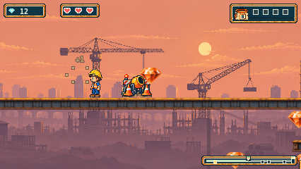
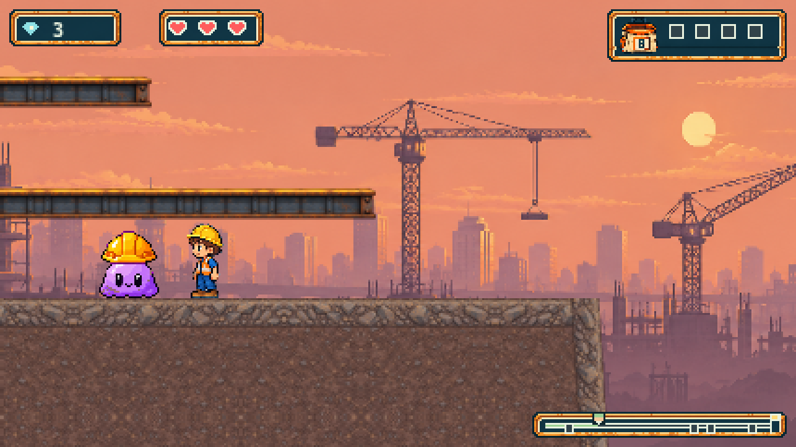

# Construction prop and moving work-yard slimes

The owner requested replacing the bush in their Sunset screenshot with
construction-site artwork and bringing back moving slimes.

`site-deco-2` stays at (1600,380), on the same girder and back layer, and now
uses the existing site atlas `stone` role: construction cones and mixer equipment.
There are no new or modified image assets and no generation calls (four of six
remain spent). The original approved steel/gravel family is unchanged.

Three hard-hat slimes patrol the existing ground at y680:

| ID | Initial X | Patrol X | Speed |
| --- | ---: | --- | ---: |
| site-slime-1 | 650 | 590–710 | 36px/s |
| site-slime-2 | 1660 | 1600–1720 | 36px/s |
| site-slime-3 | 2530 | 2470–2590 | 36px/s |

The existing patrol, contact, squash and reset behavior is reused. Patrols stay
away from the recovery gap and checkpoint approaches. All platform/terrain
geometry, ferry motion, checkpoint positions, BEAM and 62 gems (including the
38 approved offsets) are preserved. The layout equality test now permits only
these exact three additions and one asset substitution beyond the prior gem
exceptions. `owner-feedback-preservation.json` separately pins the new source;
older records and accepted artwork have not been rewritten.

## Validation

- Full unit suite: 2,074 passed in 112 files. Existing slime tests now exercise
  Sunset patrol bounds, movement, reversal, contact damage and reset.
- All 123 script tests, typecheck and production build passed.
- Thirty selected browser cases: 29 passed, one Firefox missing-A return hit
  the existing 45,000ms deadline. Its error snapshot shows Finish at X3053.
  The original failed screenshot/context and logs are retained here, with the
  complete trace/report under test-results/issue-242/site-owner-feedback/.
  This is the previously recorded timing failure; no cause, fix or waiver is
  asserted, and no deadline or retry setting changed.
- Passing cases include the main route, ferry, full missed-letter retrace,
  construction prop at native/small sizes and live slime movement/Pause in
  Chromium, Firefox and WebKit. The snapshot wait was then strengthened to
  catch a visible slime pass (the initial screenshot could catch it offscreen).
  Three additional slime capture/Pause cases all passed on that final test.
- Strict reports verified 450 initial file attachments and three final visible
  captures. Readback matched 1,188 runtime source hashes, 1,292 served/build
  bodies, four cache revalidation witnesses and 459 PNG checks. Precommit
  sourceRevision fields remain null, with runtime file hashes binding the actual
  candidate separately from the previous working commit.
- Full configured CI now has 870 cases; fresh CI and whole-PR review are pending.

## Inspected ordinary-input gameplay

The construction prop at its original girder position:

Small CSS display:

A hard-hat slime patrolling the ground-level work yard, reached using controls:

Owner completed-trail acceptance remains separate and pending. These requested
changes do not authorize merging, deployment or issue closure.
