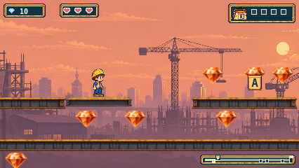
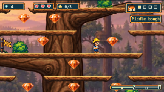

# Sunset integration with merged Treetop Timbers

Main `0164598` brings in the completed Timbers artwork from PR247. The shared
loader and renderer now retain Timbers, Plains and Sunset together. Timbers'
fixed boughs omit white endpoints; Sunset omits every platform path marker,
including the ferry's. Moving platforms on other trails retain their markers.
The manually assembled HUD/map renderer graphs include both trails' modules.

## Preservation

The new `assets/source/site/steel-v1/timbers-main-preservation.json` reverses only
exact candidate loader/renderer bytes to copies of merged main. Existing
Timbers and Plains projections then check their original historical records.
Neither those records nor previous Sunset records were rewritten. Negative
controls still reject appended bytes, unauthorized positions and changed hunks.
Timbers hunk mutations operate on the exact projected main bytes, so the
original hunks remain present when the negative controls run.

`integration-byte-audit.json` compares all 136 existing runtime/public files
outside Sunset's four approved integration paths to main. It also compares
all 87 existing Sunset source/asset files and level data to the previously
reviewed `6aa7128`. Every comparison matches. There are no new generation calls;
four of six remain spent. Geometry, 38 approved gem offsets, steel/gravel images
and moving-platform behavior remain accepted and unchanged.

## Validation

Typecheck/build, the complete 2,071-unit suite and all 123 script tests pass.
The full configured browser catalog now contains 861 cases. The initial 42-case local matrix passed 38 and failed four Firefox Sunset
cases because the old collectors attempted body reads on HTTP 304 revalidations.
Timbers now shares Plains scenery, causing a second manifest request. Both
Sunset collectors now use main's existing cache observer: each 304 is retained
and must bind to an earlier 200 at the exact URL. Every 200 body still must match
the build. The observer's 20 unit tests pass, including missing/wrong cache-body
negative controls. No game code, routes, retries or deadlines changed.

All 12 affected Sunset cases then passed in a separate three-engine rerun, with
zero skips/retries. This gives coverage from 30 unaffected passing cases in the
original run plus 12 corrected cases, not one 42-case passing run. Both strict
reports and the original four failures are retained. Readback checked 1,272 source
hashes, 1,414 served/build bodies and 753 PNG CRC/dimension checks. Precommit source
revision fields remain null, with actual runtime hashes bound separately.

Timbers' unchanged test metadata retains body-read errors for bodyless 304 rows.
Readback matched each to an earlier 200 at the same recorded asset path and to
current build bytes; these bindings are recorded in readback.json. No failed 200
body read was accepted. This does not claim URL fields absent from that metadata.

The initial integration checks identified a missing Timbers projection in the
Sunset historical manifest guard and three negative controls that tried to
mutate old literals directly in combined source. Correct projection ordering
resolved these failures. The original local logs remain under
`test-results/issue-242/timbers-main/`; assertions and guards were preserved.

Earlier timing failures remain recorded and unwaived: the Firefox missing-A
45-second CI return deadline, the Plains pixel-analysis timeout, earlier
finish-layout timeouts and the WebKit Plains Retry movement failures reproduced
on untouched main. A later pass is not a root-cause finding or waiver.

Fresh whole-PR review and exact-head/current-base CI with downloaded-artifact
readback are required for this integration. The owner confirmed on 2026-11-03
that the completed Sunset trail has not yet been playtested. Whole-trail
acceptance remains open; no merge, deployment or issue closure is authorized.

## Inspected gameplay

Sunset ferry at native size, without white path markers:

Timbers at a 320px window, with the connected tree and branch family retained:

