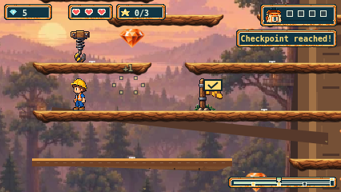
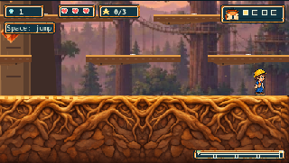

# Treetop Timbers representative artwork preview

This is the historical terrain-only preview. The owner subsequently added the trunk and six scenic limbs; see the [tree addition](timbers-tree-addendum-241.md). Results and candidate bindings below belong to the pre-tree revision.

The approved preview replaces the ground and 12 selected branch supports with illustrated bark/root artwork and removes the 11 specifically approved unsupported pine/log-stack decorations. All support, pickup, checkpoint, finish/retrace, movement and camera data remain unchanged. The remaining 32 branches intentionally keep their existing art while this representative treatment awaits owner acceptance.

Scope and approval: [measured plan](timbers-art-plan-241.md), [authorization and call ledger](../assets/source/timbers/illustrated-v1/authorization-and-budget.json). That terrain-only candidate was uncommitted on `t3/refresh-treetop-artwork`, based on verified remote main `885b6c16d5397e061f1ccb40ca326856bc77db88`. No commit, push, PR, merge or deployment was requested or performed.

## Artwork and source

Three of the five authorized generation calls were used through the built-in imagegen tool. A supplies complete branch ends and a repeatable centre at one native scale; its reuse on the broad middle bough leaves the B allocation unused. C's first output had stray alpha outside the terrain block, so its one allowed refinement produced an opaque full-bleed ground source. The rejected output is preserved.

- [Original images, exact executed prompts and returned metadata](../assets/source/timbers/illustrated-v1/PROVENANCE.md).
- [Prepared native assets and support manifest](../public/assets/timbers/terrain-kit-v1/manifest.json).
- [Preparation and complete output-pixel bindings](../assets/source/timbers/illustrated-v1/preparation.json).

Branches are 17px deep at native scale and retain whole shaped ends. Typical 60px support spacing leaves at least 3px against Henry's 40px standing silhouette. The spring reward/catch overlap is still an intentional one-way crossing; the demonstrated catch rest remains beyond the reward's right end. No notches, alpha keys, pixel repairs, nonuniform scaling or geometry changes were used to make these assets fit.

The real game loads the kit as a required Timbers-only resource and uses one native draw per prepared support. Unavailable metadata or image files use ordinary loading error/Retry. Map thumbnails and renderer fixtures load the same assets. The approved central trunk, six decorative connecting limbs, panorama and ambient leaves remain.

## Verification and evidence

The initial targeted Chromium 426px input journey passed. It includes roots, middle, standing under the spring, spring reward/catch/retry, full ascent, return through the middle edge and two zigzag supports, and all four letters at the roots. It measures the actual rendered Henry alpha silhouette, asserts standing contact against unique authored supports, and checks delivered asset bytes against the production build. [Pilot report and images](evidence/issue-241/preview-pilot/).

[Supplemental flight and ground-end evidence](evidence/issue-241/preview-flight/report.json) captures both ground ends, reverse traversal and two actual spring-flight poses at 426 and 320px CSS widths. All 16 PNG hashes were verified and the images inspected. The first diagnostic attempt's 720px single walk exceeded the existing pilot's 200-frame allowance near x73; it remains in `preview-flight-initial/`. The final diagnostic splits that long walk at x400 using the same input pilot and unchanged frame limits. No game geometry or gameplay was altered to obtain the captures.

Local checks:

- Full unit run: **1,946 passed, two failed** across 98 files. Both failures are 5-second deadlines in the unchanged `tests/finish-layout.test.ts` cases for zero and one gem (observed 7203ms and 6849ms). Their cause is not established; no assertion, deadline or retry was changed. [Raw unit log](evidence/issue-241/preview-verification/unit-full.log).
- All 99 script tests passed, including deterministic reproduction, strict PNG/RGBA equality, whole-end/centre provenance and negative controls against unrelated shared-source edits. [Raw script log](evidence/issue-241/preview-verification/scripts-full.log).
- Typecheck and production build passed. [Final typecheck](evidence/issue-241/preview-verification/typecheck-final.log), [final build](evidence/issue-241/preview-verification/build-final.log). Rebuilding after the test-locator correction reproduced all existing candidate file hashes.
- Full configured browser suite: **677 passed, 12 failed, one skipped**, with zero retries. Every one of the 690 reported case identities matches the configured inventory. Nine failures were the new Retry-test locator mismatch described below; three were Cove deadline failures. The Firefox audio skip explicitly reports that native AudioContext cannot run without an audio backend on this host. [Full-run verification and artifact index](evidence/issue-241/preview-verification/full-browser/verification.json), [raw run log](evidence/issue-241/preview-verification/full-browser/run.log).
- All six new Timbers journeys passed in that full run: Chromium, Firefox and WebKit at both 426px and 320px. Readback verified all 120 PNGs, their metadata hashes, all ten required kit URLs' successful delivered bodies against the build, and a 3px native standing gap in every under-spring capture. Repeat responses whose bodies were unavailable were recorded as HTTP 304, each with a matching successful 200 body in the same journey. All 211 candidate file bindings remain unchanged. [Capture validation](evidence/issue-241/preview-verification/capture-validation.json).
- After correcting two exact button-name locators from `Retry` to the existing `Retry loading`, all nine required-resource cases passed across the three engines, with no skips or retries and unchanged 30-second test deadlines. The original failures and original test source are retained. This test-only correction changed no runtime file, assertion meaning, route or deadline. [Exact correction](evidence/issue-241/preview-verification/retry-correction/correction.json), [rerun verification](evidence/issue-241/preview-verification/retry-correction/verification.json), [raw rerun report](evidence/issue-241/preview-verification/retry-correction/browser-report.json).

The three browser deadline failures are all in the unchanged `Cove B Hollow/Pools ordinary input rests` test, each exceeding its existing 120-second total deadline:

| Browser / width | Last observed state | Pilot group being awaited | Evidence |
| --- | --- | --- | --- |
| Chromium / 426px | x2349, y310 | Walk to x2350 | [Context](evidence/issue-241/preview-verification/full-browser/cove-rollout-Cove-B-Hollow-3b5ba-dinary-input-rests-at-426px-chromium/error-context.md) |
| WebKit / 426px | x2414, y250 | Walk to x2380, jump to x2420/y284, walk to x2420 | [Context](evidence/issue-241/preview-verification/full-browser/cove-rollout-Cove-B-Hollow-3b5ba-dinary-input-rests-at-426px-webkit/error-context.md) |
| WebKit / 320px | x2402, y250 | Same x2380–2420 group | [Context](evidence/issue-241/preview-verification/full-browser/cove-rollout-Cove-B-Hollow-cc490-dinary-input-rests-at-320px-webkit/error-context.md) |

These observations establish where each deadline expired, not its cause. The two unit deadlines and three Cove browser deadlines remain unresolved local gates. No assertion, deadline or retry was weakened, and the full runs are not represented as clean.

The complete raw browser report and all 445 selected file-backed attachments (Timbers journeys and failed cases) remain in the ignored local `playwright-report/issue-241/full-browser/` archive. The 405MiB raw report is stored there as a 278MiB gzip whose decompressed SHA-256 matches the original report; the original also remains in `test-results/`. The verification index records the path mapping and every retained attachment hash. The smaller repository review packet contains the Timbers journeys and failed-case contexts/screenshots. The local raw archive is not claimed to be committed or uploaded.

[Candidate bindings](evidence/issue-241/preview-verification/candidate.json) distinguish the uncommitted source from its base revision. Browser evidence keeps `sourceRevision:null` unless an actual supplied revision is available. Earlier baseline captures and the first pilot remain historical observations, rather than being relabelled as later revisions.

The pre-implementation tracker check found no competing Timbers work. Plains [PR245](https://github.com/auleewilliams/TinyTurboTrails/pull/245) overlaps the shared loader, renderer and fixture integration points; reconcile the then-current main/PR state before any later rollout or publication. This preview does not claim those future integration or PR gates.

## Owner review

Review the roots and the middle/spring/return treatment at native 426×240 and 320px CSS size. Assess whether the wood reads as substantial organic boughs, the longer repeat remains coherent, branch ends/landings are easy to read, and the approved decorative removals improve the route. This is representative-preview acceptance only; the remaining branch rollout and completed-trail playthrough follow separately. The unresolved unit and Cove browser deadlines are separate from visual acceptance; later rollout and publication still require their applicable gates.

