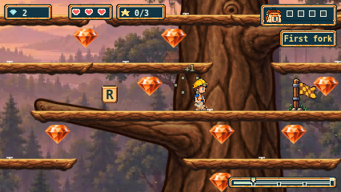
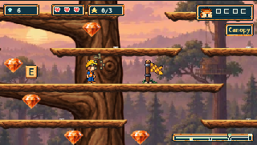

# Main integration for Timbers PR #247

This update resolves the conflict with main `fbf98b93d0c28e7cd393b1b7213a3dc2b3a2bacb` (Plains PR #245) from Timbers parent `0351b48d2bb7a19b928d7a68fa569ea1ce389a37`.

The shared loader now retains both worlds’ declarations, validation and returned assets. The renderer retains Plains’ continuous contour draw and edge clipping alongside Timbers’ illustrated ground, all 44 fixed supports and scenic tree. Function-string and source-module fixtures carry both dependency graphs. No Timbers artwork, mapping, geometry or input code changed; Plains runtime modules and PNGs are identical to main.

The dated Timbers, Plains and Cove provenance records remain unchanged. A separate [integration record](evidence/issue-241/main-integration/presentation-delta.json) pins the complete merged files and reversible literal hunks against both exact parent revisions. The historical Timbers chain first projects the five incoming Plains presentation changes back to its parent; the historical Plains chain projects only the two shared files back to its parent. Complete hashes and negative controls reject foreign edits, historical inputs and altered hunks before the original preservation oracles run. These are exact integration projections, not exceptions for arbitrary edits.

Local checks on the combined candidate:

- Type-check and production build pass.
- All 115 script tests pass, including both original preservation chains and new integration negative controls.
- The default-concurrency unit run retained four existing five-second deadline failures (three finish-layout cases and one Plains full-cache pixel case), with 2,041 passing. A separate complete run with `--maxWorkers=2` passes all 2,045 tests across 110 files in 130.78 seconds; assertions and timeouts are unchanged. Both logs are retained in [check evidence](evidence/issue-241/main-integration/check-log-hashes.json).
- Native browser run: **125 passed / one failed**, zero skipped/flaky/retried cases, across 126 selected cases in Chromium, Firefox and WebKit (17m08s). All selected Timbers cases, all twelve Timbers artwork journeys, and all six Plains input journeys passed. The complete merged browser configuration contains **741 cases**.
- The sole browser failure was WebKit’s existing Plains soil Retry test: restored assets reached Playing, but the subsequent traversal did not reach X700 within its original 20-second budget. Its preserved controller history marks 390 of 508 traversal samples late; the final sample is X567.559. A separate unchanged, one-worker rerun passed in 15 seconds. The original failure remains a failure; no code fix, timeout increase, inferred root cause or waiver is claimed.
- Readback audited **785 file attachments and 324 inline attachments**, with PNG structure and capture-hash checks, all 44 Timbers supports, route completion and source/served/build hashes. Separate Plains readback covers six journeys, 192 capture PNGs and exact decoded RGBA/cache hashes. All **551** source/build/asset/test checkpoint files remained unchanged. See [local results](evidence/issue-241/main-integration/local-results.json), [native audit](evidence/issue-241/main-integration/native-verification.json), [isolated Retry audit](evidence/issue-241/main-integration/retry-verification.json), and [Plains readback](evidence/issue-241/main-integration/plains-readback.json).

Complete original reports, traces and images remain under ignored `playwright-report/issue-241/main-integration` and `main-integration-retry`; audit entries preserve those local paths and hashes. This committed packet includes selected views, summaries and exact bindings, not the full local archives. Precommit `sourceRevision` fields remain unchanged; the checkpoint is separately bound to the published commit. No generation calls were used. Earlier rollout evidence remains bound to its original head and is not evidence of this integration’s checks. The full canonical CI run, a fresh whole-PR Claude review, artifact readback and the owner’s completed-trail playthrough remain separate gates.

