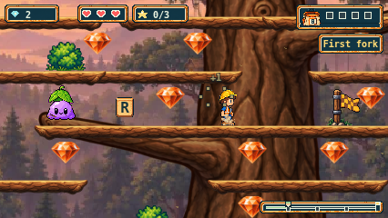
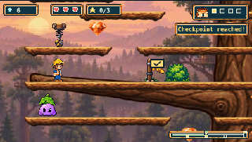

# Timbers owner playtest follow-up

The owner requested removing the small white T on each platform, adding bushes
on the platforms, and restoring a few slimes. This extends the earlier art-only
scope with eight decorative entities and three live enemies. Earlier approvals,
source records and failed evidence remain historical and unchanged.

## Result

- Fixed Timbers platforms no longer draw overlapping travel-path endpoints. Real
  moving platforms retain their path cues; other trails retain their behavior.
- Eight round bushes reuse the existing Plains foreground sprite at its normal
  44×32 size. The Timbers manifest references the existing scenery bundle; only
  its bush sprite is drawn. Timbers retains its own panorama, tree and terrain.
  The bush bases align with platform planes and render behind Henry and pickups.
- Three leaf-capped slimes occupy `(200, 900)`, `(80, 720)` and `(210, 420)`.
  Their existing bounce behavior rises up to 6px every two seconds. They stay in
  place, damage on side contact, and flatten when stomped. Ground-following
  patrols are deliberately not assigned to elevated supports.
- Squashing a stationary creature now rests its flattened sprite at its authored
  base plane. Ground patrols still use the ground height at their live X position.
  This prevents a stomped branch slime from teleporting visually to the roots.

The 44 platform bodies, ground, start/finish/checkpoints, collectibles, movement
physics, controls and camera are unchanged. No production PNG, source asset or generation
record changed. No generation calls were used; the original two reserves remain.

Actual keyboard-driven gameplay, native 426×240 at the first fork:

Actual 320px CSS gameplay at the middle bough and spring:

## Preservation and verification

The [exact follow-up delta](evidence/issue-241/owner-feedback/presentation-delta.json)
pins all four changed runtime/asset-declaration files against `039866f`.
`scripts/timbers-owner-feedback.mjs` checks each complete current file, reverses
only the recorded edits, then checks the complete historical file. This layer
feeds the existing Timbers/Plains/Cove historical preservation tests. It rejects
unrelated changes and historical input instead of relaxing the old byte pins.

New focused checks cover stationary/moving platform markers, the actual bush
sprite and unchanged backdrop, full sprite support, pickup/checkpoint clearance,
all three slime hop bounds, damage, stomp resting planes and reset. Existing
ground-patrol assertions still apply to every slime on the other trails.
Ground landing-band tests now account for elevated enemies being on a different
plane, while retaining the horizontal exclusion for ground patrols.

Native input journeys additionally record all eight bush draws and all three
slime draws at every gameplay capture. Assertions bind bush bases to the branch
planes and slime bases to their six-pixel bounce envelope. Existing ascent,
spring, all-star, return/re-ascent, finish re-arm, Retry and viewport checks remain.

Local logs and file-backed browser reports are retained under the ignored
`playwright-report/issue-241/owner-feedback/` directory. The initial unit run
caught a return-path collision and a flattened sprite falling to the root plane;
those failures remain retained. The middle slime moved to the left side bough
and the squash resting-plane bug was fixed before final verification.

Final verification results are recorded in
[verification.json](evidence/issue-241/owner-feedback/verification.json).
All 2,053 units, 116 preparation/preservation tests, type-checking, build, and
78 Timbers browser checks passed. Browser readback verified 780 PNGs, 558 file
attachment references and 12 source/build-bound artwork journeys across the
three engines. Actual 426px and 320px captures were visually inspected.

The additional shared slime suite passed 10/12 initially. Both WebKit native
control cases expired at the unchanged five-second approach deadline before
stomping (keyboard X1440; controller X1557), while another browser run was active.
Both passed in a separate one-worker run after the Timbers run finished, with
the same code, assertions and time limits. The initial failures and traces are
retained; concurrency is a possible cause, not an established diagnosis. This
does not waive those failures or substitute for the full canonical CI run.

Fresh whole-PR review and canonical CI must target the new commit; the earlier
`039866f` CODEPASS and green CI are historical. Owner acceptance and merge remain
separate from automated verification.
