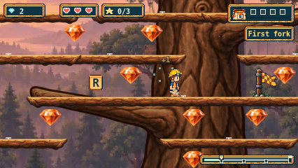
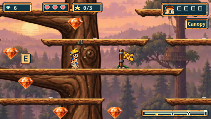
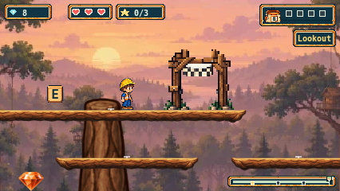

# Complete Treetop Timbers artwork rollout

The results below describe the pre-merge rollout at `0351b48`. See [main integration](timbers-main-integration-241.md) for the conflict resolution with Plains PR #245 and its separate validation.

The owner accepted the connected-tree preview at `abe92dd900c45c883f2e984812058991a46507b9`: “It's looking good, keep going!”. This continues the approved #241 plan across the remaining 32 platforms. The completed trail still needs its separate owner playthrough.

All 44 existing fixed platforms now use the accepted illustrated branch family. Seven additional native widths complete the mapping; they use whole end caps and the same copied/repeated centre at 17px depth. The accepted tree and six scenic limbs, ground and twelve preview platform PNGs remain byte-identical. No generation calls were needed. All support/pickup/checkpoint/finish geometry, routes, camera, physics, controls, shared artwork and other trails remain unchanged. No moving-platform, slope or crumble category exists in this trail.

[Accepted sources and rollout preparation](../assets/source/timbers/rollout-v1/PROVENANCE.md) · [Target ledger](evidence/issue-241/rollout/targets.json) · [Original bounded plan](timbers-art-plan-241.md) · [Historical connected-tree preview](timbers-tree-preview-241.md).

The required manifest now validates every support ID and width. Missing declarations, entries or PNGs fail visibly and use ordinary Retry. Each support still draws one native bitmap, including under fractional camera movement. Existing map and renderer-fixture consumers use the complete kit. The sole new shared-loader guard is explicitly recorded before the historical preservation oracles; those oracles and the old source/evidence records retain their original meaning.

## Local verification and remaining delivery gates

- Full units: **1,953 passed in 99 files**. Full script suite: **106 passed**. Typecheck and production build passed. The focused 21-unit / 10-script checks also passed.
- Initial Chromium pilot: **16 passed, two failed**. Both new left-route captures froze the game after horizontal movement ended but before Henry landed (expected catch plane360, still airborne). The original report, source, screenshots and traces are retained. The capture now waits for the unique authored catch plane using the existing expectation deadline, retaining the original route, movement driver, final plane assertion and 120-second test timeout. The focused repair run passed both viewport cases. [Pilot evidence](evidence/issue-241/rollout/pilot/verification.json) · [Repair run](evidence/issue-241/rollout/landing-fix/verification.json).
- Stable-candidate native run: **105 passed, zero failures/skips/retries** across Chromium, Firefox and WebKit in 11m15s. The exact configured identities reconcile independently with Playwright's selected enumeration. Coverage includes both forks, all special routes, spring retry, missing-letter return/re-ascent and finish re-arm, Pause/reduced motion, map/HUD/renderer fixtures, and required-resource recovery.
- All twelve expanded art journeys passed: six main ascent/return journeys with 19 route groups each, and six left-fork/wrong-end journeys with six groups each. They retain **306 PNGs** including map, Pause and finish views. Every support has a framed screenshot witness in all six engine/width cohorts; every capture independently validates the 44 native image draws against authored supports. Native spring clearance is 3–4px.
- Audit passed for all **561 file attachments and 255 inline attachments**, preserving content-addressed inline copies. PNG signatures, CRCs, dimensions, decompressed scanline lengths and filters were checked. The 294 paired-state/map PNG hashes plus Pause hashes match their metadata; finish and recovery images are bound to the raw report and archive. All **282 frozen source/build/asset/test hashes** remain unchanged. Served 200 bodies match the current build; 304 body-read errors remain recorded. [Native audit](evidence/issue-241/rollout/native/verification.json) · [Local results](evidence/issue-241/rollout/local-results.json).
- Full configured CI (**729 cases**), fresh Claude whole-PR review and exact-head artifact readback remain pending publication. Current local checks are not a claim that those delivery gates have passed.
- Historical failures remain recorded: the accepted preview had one local finish-layout unit deadline, two WebKit Cove input-route deadlines, and one conditional Firefox AudioContext skip. Earlier terrain-only failures remain separately retained. No cause, fix or waiver is inferred.

Open/draft PRs245 (Plains) and246 (Sunset) were rechecked, including actual shared-loader/renderer patches. Neither implements Timbers. Remote main remains `885b6c16d5397e061f1ccb40ca326856bc77db88`; shared-file changes need reconciliation if that base changes before publication. Merge, deployment and issue closure remain separate from this rollout and its owner playtest.

## Actual rollout views

Input-driven Chromium captures from the completed selected run. Firefox and WebKit native/small views were also inspected. These are not layout fixtures or source-art mockups.

The original full reports and traces are retained locally under ignored `playwright-report/issue-241/rollout-pilot`, `rollout-landing-fix` and `rollout-native`. The repository contains curated images, source snapshots and exact report/attachment bindings; it does not claim those entire local archives are uploaded. The earlier preview evidence remains unchanged.
