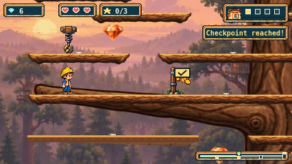
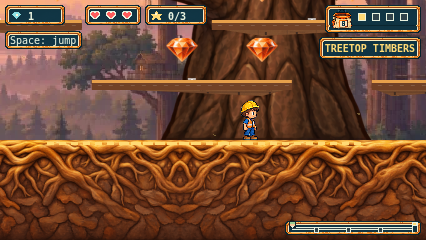
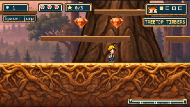
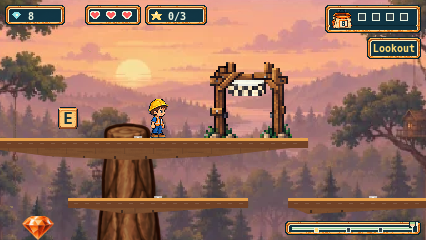

# Timbers preview with the connected tree

The owner-authorized tree addition is integrated into the same issue #241 work. A new whole transparent bitmap replaces the central code-drawn trunk and all six scenic limbs in production. Its darker illustrated bark complements the existing branch/ground family, while the real platforms keep their bright walking tops. The earlier 12-platform/ground PNGs and their entire kit remain byte-identical. The other 32 platforms still await the representative-preview acceptance and rollout gate.

[Scope and separately approved budget](timbers-tree-addendum-241.md) · [Original sources, executed prompts and preparation](../assets/source/timbers/tree-v1/PROVENANCE.md) · [Required native tree asset](../public/assets/timbers/tree-v1/tree.png).

The two separately authorized tree calls were used: one connected source, then its single refinement to quiet the initial golden highlights. This makes five total calls across terrain and tree, within the combined seven-call cap. The original unused B allocation and A refinement remain untouched; no more tree generation is authorized.

## Actual source and integration

The selected 971×1620 RGBA source is uniformly filtered to one native 576×960 image. No crop, alpha key/threshold, mask, tint, pixel repair or anisotropic scaling is used. The 210 contiguous substantial base pixels on native row939 meet the unchanged ground y1080 when the full tree is drawn at (32,140). Its faint original fringe below that base remains in the PNG and is naturally occluded by the foreground ground, with no image editing. The root flare lies entirely over the existing supported ground. Rounded connectors are decorative: they add no collision or standing space.

The required tree declaration, metadata and PNG all fail visibly and recover through ordinary Retry. One native image draw replaces the old trunk rendering in its existing background layer, before terrain, platforms, pickups and Henry. Cached trail thumbnails and manual renderer fixtures load the same tree dependency. Gameplay geometry, pickups, finish/retrace, controls, physics and camera remain unchanged; the removed 11 decorations stay removed. The forest panorama and ambient leaves are unchanged.

[Candidate bindings](evidence/issue-241/tree-preview/verification/candidate.json) identify the uncommitted candidate with 255 source, test, provenance and asset/build hashes. Earlier terrain-only evidence remains historical; it is not relabelled as the tree candidate. Shared-source preservation reverses only the separately pinned tree delta before the unchanged earlier Timbers/Cove oracles and rejects unrelated edits.

## Verification

- Focused source checks: **24 unit tests and six preparation/preservation tests passed**.
- Full script suite: **102 passed**. Exact source/prepared PNG/RGBA, six outer limb regions, the contiguous grounded base, previous terrain file hashes, reproduction and preservation negative controls passed.
- Full unit suite: **1,951 passed, one failed** across 99 files. The unchanged finish-layout zero-gem case exceeded its 5,000ms deadline at 8,387ms. Its cause remains unknown; no assertion, deadline or retry changed. Historical two unit deadlines and three Cove browser deadlines from the earlier candidate are retained and not waived.
- Production build and final typecheck passed.
- First Chromium pilot: **four passed**—the 426px journey plus required tree metadata, image and declaration failure/Retry cases. [Raw report](evidence/issue-241/tree-preview/pilot/browser-report.json).
- Expanded Chromium journeys: **two passed**, at 426px and 320px, including a centred root walk/return so the whole base is visible, map thumbnail, spring clearance/catch/retry, lookout and return to the roots. All **50 PNG hashes** were verified. [Raw report](evidence/issue-241/tree-preview/pilot-centred/browser-report.json). The first pilot remains separately retained with its own test source.
- Full configured Chromium/Firefox/WebKit suite: **696 passed, two failed, one skipped**, in 86m25s. All **699 configured identities** reconcile exactly, including multiplicities, with 699 attempts and **zero retries**. The two failures are WebKit's unchanged Cove B Hollow/Pools input route at 426px and 320px, both exceeding the existing 120,000ms deadline. Final observed states were x2434/y250 and x2414/y250 respectively; their causes remain unresolved. The Firefox native AudioContext case conditionally skipped because this host lacks an audio backend. No assertion, deadline or retry was relaxed.
- All **24 Timbers browser cases passed**: six full input journeys, nine terrain failure/Retry cases, and nine new tree failure/Retry cases. The six journeys each complete 12 route groups and preserve 25 verified PNGs, for **150 captures** total. Native spring clearance is 4px in Chromium and 3px in Firefox/WebKit. Every journey verifies one native whole-tree draw before terrain, root contact with the ground, map use, delivered asset hashes and the unchanged source/build bindings. Successful 200 response bodies match the build; the recorded 304 response-body read errors remain in the evidence.
- The final audit verifies all **255 candidate files unchanged**, all **1,399 file-backed report attachments**, and 274 curated review files. The original plan hash and the earlier terrain-kit hashes still match. [Verification and artifact bindings](evidence/issue-241/tree-preview/full-browser/verification.json) · [All case results](evidence/issue-241/tree-preview/full-browser/case-results.json) · [Audit log](evidence/issue-241/tree-preview/verification/full-browser-audit.log).

The exact raw report, run log, traces and complete file-backed outputs remain in the ignored local `playwright-report/issue-241/tree-full/` directory; they are not claimed as committed or uploaded. Its raw report SHA-256 is `06bfa23966b0d7fe74d06a51b5b22b3cd9e664e67d3c775f51c271cae3cadd91`. Report attachment paths resolve directly in that directory. The repository packet contains the curated Timbers views and failed-case screenshots/context. [Reproducible audit](evidence/issue-241/tree-preview/verification/audit-full-browser.py).

Current failed browser contexts: [Cove 426px](evidence/issue-241/tree-preview/full-browser/cove-rollout-Cove-B-Hollow-3b5ba-dinary-input-rests-at-426px-webkit/error-context.md) and [Cove 320px](evidence/issue-241/tree-preview/full-browser/cove-rollout-Cove-B-Hollow-cc490-dinary-input-rests-at-320px-webkit/error-context.md). Earlier terrain-only failures remain separately retained; passing observations in this run do not establish a fix for their unknown causes.

[Unit log](evidence/issue-241/tree-preview/verification/unit-full.log) · [Script log](evidence/issue-241/tree-preview/verification/scripts-full.log) · [Build log](evidence/issue-241/tree-preview/verification/build.log) · [Final typecheck](evidence/issue-241/tree-preview/verification/typecheck-final.log).

## Review views

These are actual input-driven Chromium production-game captures from the completed full run. Native spring/lookout and actual 320px root views were also visually inspected in Firefox and WebKit. The generated sources and code-derived layout guide remain separately identified.

The tree and terrain together remain a representative preview for owner acceptance. On 2026-11-02, the owner authorized committing and pushing this worktree to origin. The remaining platform rollout still requires visual acceptance; PR creation, merge, deployment and issue closure remain separate steps. Open Plains PR245 and Sunset PR246 overlap shared integration files; reconcile main and those PRs before future integration.
